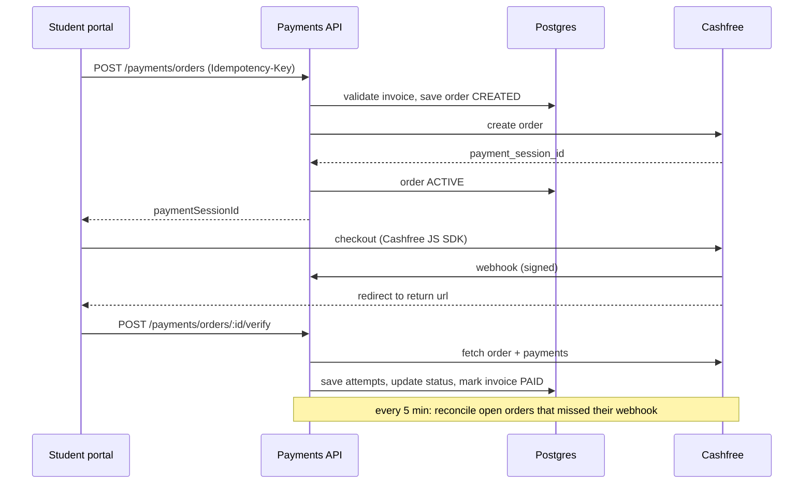

# UMS Payments – Cashfree Payment Module

Backend payment module for a University Management System (UMS/ERP). Students pay fee invoices
(tuition, hostel, exam fees, fines) through the **Cashfree Payment Gateway**, and the ERP always
knows the correct status of every payment – from order creation to the invoice being marked paid.

**Stack:** NestJS 10 (TypeScript) · PostgreSQL 16 · Prisma · Cashfree PG API `2026-01-01` · Jest · Docker

---

## Setup

Requirements: Node.js 20+, Docker Desktop, Cashfree merchant account in **Test mode**.

```bash
git clone https://github.com/swatishah946/UMS_payment_system.git
cd UMS_payment_system
npm install
cp .env.example .env        # fill CASHFREE_APP_ID and CASHFREE_SECRET_KEY (sandbox keys)

docker compose up -d        # postgres on localhost:5433
npm run db:deploy           # run migrations
npm run db:seed             # 2 students + 5 fee invoices
npm run start:dev
```

| URL | |
|---|---|
| http://localhost:3000 | Demo page – pay an invoice through Cashfree sandbox checkout |
| http://localhost:3000/docs | Swagger – all APIs with request/response schemas |
| http://localhost:3000/health | Health check |

### Try it

Open http://localhost:3000, pick a student and click **Pay** on an invoice. Cashfree's sandbox
checkout opens; use their [sandbox test data](https://www.cashfree.com/docs/api-reference/payments/data-to-test-integration),
for example UPI `testsuccess@gocash` (success) or `testfailure@gocash` (failure). After checkout
you are sent back to the page, which verifies the order and shows its status, attempts and history.

Things worth trying: pay → `PAID` (invoice marked paid) · fail then pay again on the same invoice
(same order, two attempts) · close the checkout and click **Verify** · **Cancel** an unpaid order ·
**Run reconciliation**. While a payment is `PENDING` the invoice can't be paid again (prevents double
charging); it resolves to `PAID`/`FAILED`/`EXPIRED` through verify or reconciliation.

To see the admin guard, set `ADMIN_API_KEY=some-key` in `.env` and restart: cancel/reconcile then
return `401 ADMIN_KEY_REQUIRED` unless the `x-admin-key` header matches (Swagger shows the field;
the demo page asks for the key).

**Webhooks locally (optional):** run `ngrok http 3000` and set
`PAYMENT_NOTIFY_URL=https://<id>.ngrok-free.app/webhooks/cashfree`. Without webhooks the module still
reaches the correct status through the verify API and the reconciliation job.

### Deployment

The repo contains a `Dockerfile` and a Render blueprint (`render.yaml`: app + PostgreSQL). On
startup the container runs migrations, seeds demo data if the database is empty, and starts the
app. When deployed, the return and webhook URLs are derived from the public URL automatically
(`PUBLIC_URL`, or Render's `RENDER_EXTERNAL_URL`). Only the Cashfree keys need to be set.

### Environment variables

| Variable | Description |
|---|---|
| `DATABASE_URL` | Postgres connection string |
| `CASHFREE_APP_ID`, `CASHFREE_SECRET_KEY` | Cashfree API keys (secret is also used to verify webhooks) |
| `CASHFREE_ENV` | `sandbox` or `production` |
| `CASHFREE_API_VERSION` | Cashfree `x-api-version` (default `2026-01-01`) |
| `PAYMENT_RETURN_URL` | Where Cashfree sends the student after checkout (`{order_id}` filled by Cashfree) |
| `PAYMENT_NOTIFY_URL` | Public HTTPS webhook URL (optional) |
| `ADMIN_API_KEY` | If set, `cancel` and `reconcile` require an `x-admin-key` header with this value (NestJS Guard). Empty = open, for local use |
| `PUBLIC_URL` | Public base URL when deployed; return/webhook URLs are derived from it if not set |
| `ORDER_EXPIRY_MINUTES` | Time a student has to pay an order (default 30) |

---

## Payment workflow



**Core rule:** the redirect and the webhook body are only signals. Before changing a status the
module always fetches the order and its payments from Cashfree. Webhook, verify API and the
reconciliation job all call the same `PaymentsService.syncOrder`, so the status rules live in one place.

---

## Order statuses

| Status | Meaning |
|---|---|
| `CREATED` | Saved locally, Cashfree order not created yet (or Cashfree was unreachable) |
| `ACTIVE` | Cashfree order created, waiting for payment |
| `PENDING` | Payment in progress at bank/UPI – new payment and cancel are blocked |
| `FAILED` / `USER_DROPPED` | Last attempt failed / checkout closed – student can retry on the same order |
| `PAID` | Payment confirmed and amount verified, invoice marked paid. Final |
| `EXPIRED` / `CANCELLED` | Order closed, a new order can be created |
| `FLAGGED` | Money received but can't be applied (amount mismatch, double payment) – needs manual review |

Allowed transitions are one lookup table in `src/payments/payment-status.ts`. Anything else is
ignored and logged, so a `PAID` order can never go back because of a late or out of order event.
`EXPIRED`/`CANCELLED → PAID` is allowed on purpose: if the bank completes a payment after we closed
the order, the money is real and must be recorded.

---

## API

Full details in Swagger (`/docs`). Errors always have the shape
`{ statusCode, code, message, path, timestamp }` so clients can switch on `code`.

| Method | Path | Purpose |
|---|---|---|
| POST | `/payments/orders` | Create (or reuse) an order for an invoice. Optional `Idempotency-Key` header |
| GET | `/payments/orders/:id` | Order with attempts and status history (`:id` = uuid or `UMS_...` order id) |
| POST | `/payments/orders/:id/verify` | Re-check with Cashfree – call on the return page |
| POST | `/payments/orders/:id/cancel` | Cancel an unpaid order (terminates it at Cashfree too). Needs admin key |
| POST | `/payments/reconcile` | Run the reconciliation job now (also runs every 5 min). Needs admin key |
| POST | `/webhooks/cashfree` | Cashfree webhook – signature checked, retries deduped |
| GET | `/students` | List students |
| GET | `/students/:id/invoices` | Fee invoices with status |
| GET | `/students/:id/payments` | Payment history |

**Admin key:** cancel and reconcile are protected by `AdminKeyGuard` when `ADMIN_API_KEY` is set (`x-admin-key` header, 401 `ADMIN_KEY_REQUIRED` otherwise).

Example – `POST /payments/orders` with `{ "invoiceId": "...", "studentId": "..." }`:

```json
{ "id": "ef930cd3-...", "orderId": "UMS_MVMQETSD_B12F01F0", "status": "ACTIVE", "amount": "150",
  "currency": "INR", "paymentSessionId": "session_...", "expiresAt": "...", "cashfreeMode": "sandbox",
  "reused": false }
```

Error codes: `VALIDATION_ERROR` (400), `INVOICE_NOT_OWNED` (403), `INVOICE_NOT_FOUND` /
`ORDER_NOT_FOUND` (404), `INVOICE_ALREADY_PAID` / `PAYMENT_IN_PROGRESS` / `ORDER_ALREADY_PAID` (409),
`IDEMPOTENCY_KEY_REUSED` (422), `GATEWAY_REJECTED` (502), `GATEWAY_UNAVAILABLE` (503 – safe to retry),
`INVALID_SIGNATURE` (401, webhook).

---

## Database

| Table | Purpose |
|---|---|
| `students`, `fee_invoices` | Minimal stand-ins for the existing ERP tables |
| `payment_orders` | One row per checkout: our order id, Cashfree ids, amount, status, expiry, idempotency key |
| `payment_transactions` | One row per payment attempt (`cf_payment_id`), with the raw Cashfree response |
| `payment_status_history` | Append-only audit of every status change, with source (`API`, `WEBHOOK`, `VERIFY`, `RECONCILE`, `ADMIN`) and note |
| `webhook_events` | Every webhook received (including rejected ones) for dedupe and debugging |

Schema: `prisma/schema.prisma`, migrations: `prisma/migrations`. Money is `DECIMAL(12,2)`.
The migration also adds SQL Prisma can't express – a partial unique index that allows **only one
open order per invoice**, and amount check constraints.

---

## Edge cases handled

All of these are covered by `test/payments.e2e-spec.ts`.

| Scenario | Handling |
|---|---|
| Double click / client retry | `Idempotency-Key` returns the same order; without a key the invoice's open order is reused |
| Simultaneous pay requests | Partial unique index allows one open order; the others return it |
| Invoice already paid / not the student's | `409` / `403` before calling Cashfree |
| Cashfree down when creating order | 3 retries with backoff, then `503`; order kept as `CREATED` and finished on next try |
| Cashfree created the order but response was lost | Retry gets "order already exists" → existing order is fetched |
| Cashfree rejects the order | Order `CANCELLED` with reason, `502` |
| Forged webhook | HMAC-SHA256 check on raw body (constant-time) → `401`; can't block the real event's dedupe key |
| Duplicate webhook | Deduped by `x-idempotency-key` / body hash; a failed event may be reprocessed |
| Out of order events (FAILED after SUCCESS) | Status comes from Cashfree's current state; `PAID` is final |
| Fail → retry → success | Same order, both attempts stored |
| Webhook never arrives | Verify on return page + reconciliation job every 5 min |
| Amount paid less than invoice | `FLAGGED`, invoice stays unpaid |
| Order expired | `EXPIRED`; next pay creates a fresh order (old one checked with Cashfree first) |
| Payment lands on a closed order after another order paid the invoice | `FLAGGED` as double payment (refund needed), never lost |
| Webhook, verify and cron updating the same order | `SELECT … FOR UPDATE` row lock inside a transaction |

---

## Design decisions

- **Cashfree is the source of truth.** Webhooks and redirects trigger a sync instead of being trusted
  directly – protects against spoofed redirects and stale or reordered events.
- **One sync function for all three triggers**, so rules are written once.
- **Explicit state machine** as a lookup table with unit tests; illegal transitions are logged, not thrown,
  because late events are normal.
- **Database guarantees under concurrency:** unique keys (`order_id`, `cf_payment_id`,
  `idempotency_key`, webhook `event_key`, invoice `paid_order_id`), the partial index, and row locks.
- **Safe retries:** our order uuid is sent as Cashfree's `x-idempotency-key`; only network errors, 5xx
  and 429 are retried.
- **Orders and attempts in separate tables** with an append-only history – answers "what happened to
  my payment?" and helps with disputes.
- **Never lose money silently:** anything that can't be applied ends in `FLAGGED` with a reason.
- **Postgres locks instead of Redis** – simpler at this scale; multiple instances would need a
  distributed lock for the cron job.

---

## Tests

```bash
npm test            # unit: state machine, webhook signature, retry rules
npm run test:e2e    # 31 end-to-end tests on a real Postgres test database
```

The e2e suite uses a separate database (`ums_payments_test`) and replaces only Cashfree's HTTP calls
with an in-memory fake (`test/fake-cashfree.ts`) that can simulate payments, failures, outages and
expiry. Signature verification uses the real implementation.

---

## Not included / next steps

- **Auth:** student login belongs to the ERP; in production `studentId` would come from the session
  (JWT guard). Admin routes already have a simple key guard; this would become role-based.
- **Refunds** for `FLAGGED` orders via Cashfree's refund API.
- **Distributed lock** for the reconciliation job when running multiple instances.
- Metrics/alerts (orders per status, webhook failures).
