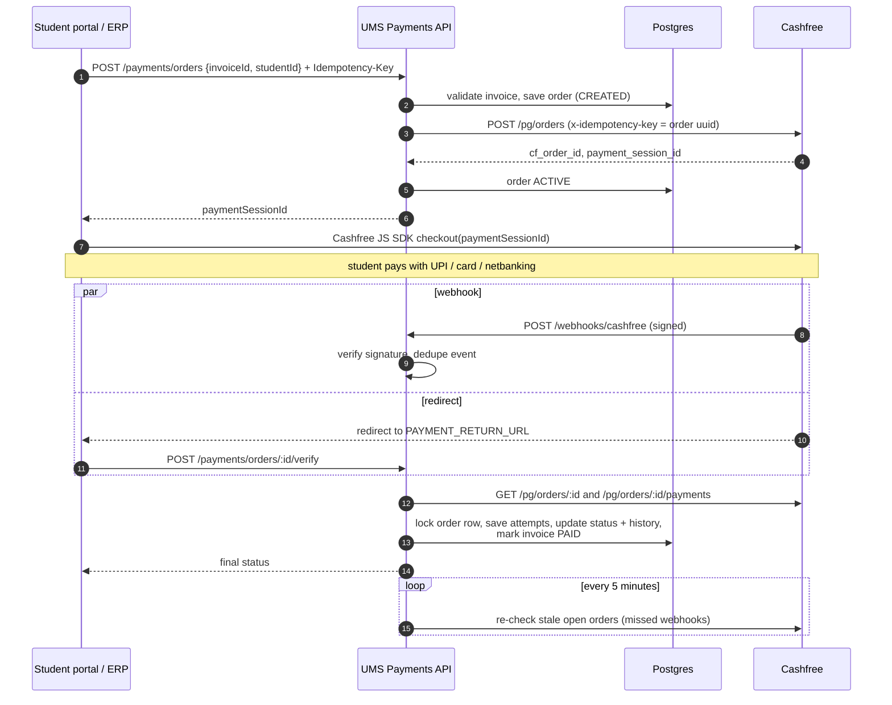
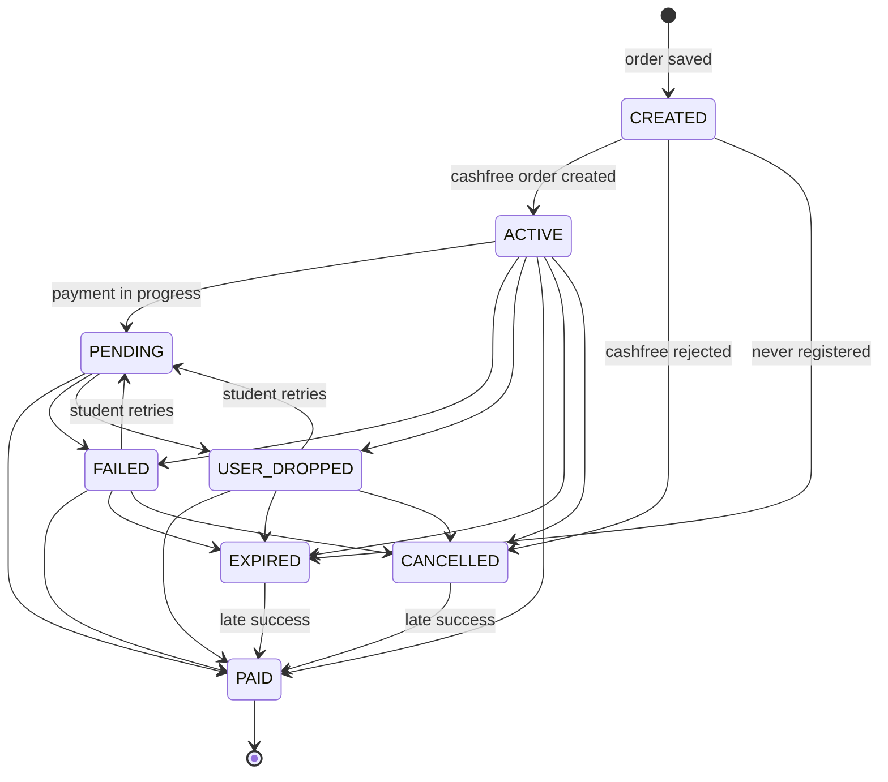
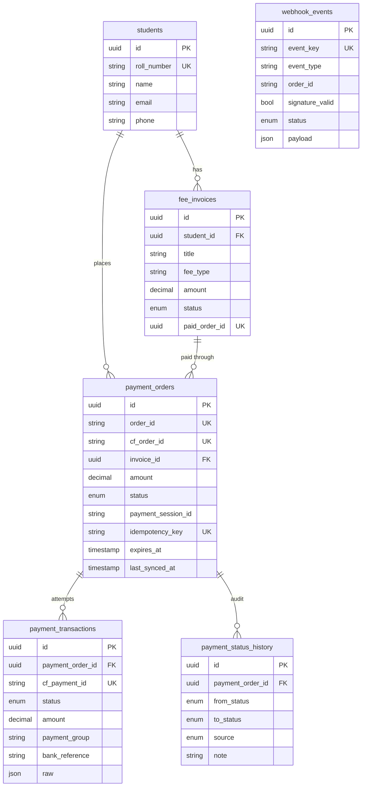

# UMS Payments – Cashfree Payment Module

Backend payment module for a University Management System (UMS/ERP). Students pay fee invoices
(tuition, hostel, exam fees, fines…) through the **Cashfree Payment Gateway**, and the ERP always
knows the correct status of every payment.

Covers the full lifecycle: order creation → checkout → webhooks → verification → reconciliation →
final status on the invoice.

**Stack:** NestJS 10 (TypeScript) · PostgreSQL 16 · Prisma ORM · Cashfree PG API `2026-01-01` · Jest · Docker

---

## Contents

1. [Setup](#setup)
2. [Configuration](#configuration)
3. [Payment workflow](#payment-workflow)
4. [Order status lifecycle](#order-status-lifecycle)
5. [API documentation](#api-documentation)
6. [Database schema](#database-schema)
7. [Edge cases and how they are handled](#edge-cases-and-how-they-are-handled)
8. [Key design decisions](#key-design-decisions)
9. [Testing](#testing)
10. [Project structure](#project-structure)
11. [Limitations / what I would add next](#limitations--what-i-would-add-next)

---

## Setup

**Requirements:** Node.js 20+, Docker Desktop, a Cashfree merchant account (test mode).

```bash
git clone https://github.com/swatishah946/UMS_payment_system.git
cd UMS_payment_system
npm install

cp .env.example .env          # then fill CASHFREE_APP_ID and CASHFREE_SECRET_KEY

docker compose up -d          # postgres on localhost:5433
npm run db:deploy             # apply migrations
npm run db:seed               # 2 students + 5 fee invoices (prints their ids)

npm run start:dev             # http://localhost:3000
```

- Swagger UI: http://localhost:3000/docs
- Health check: http://localhost:3000/health

### Getting Cashfree sandbox keys

Cashfree merchant dashboard → switch to **Test mode** → Developers → API Keys → copy App ID and
Secret Key into `.env`.

### Receiving webhooks locally

Cashfree needs a public HTTPS URL to send webhooks to. Use ngrok (or any tunnel):

```bash
ngrok http 3000
```

Then either set `PAYMENT_NOTIFY_URL=https://<your-ngrok-id>.ngrok-free.app/webhooks/cashfree` in
`.env` (sent with every order), or add the same URL in the dashboard under Developers → Webhooks.
Without webhooks the module still works: the verify API and the reconciliation job keep statuses
correct.

---

## Configuration

| Variable | Description | Default |
|---|---|---|
| `PORT` | HTTP port | `3000` |
| `DATABASE_URL` | Postgres connection string | docker compose db |
| `CASHFREE_APP_ID` | Cashfree client id (`x-client-id`) | – |
| `CASHFREE_SECRET_KEY` | Cashfree client secret, also used to verify webhook signatures | – |
| `CASHFREE_ENV` | `sandbox` or `production` | `sandbox` |
| `CASHFREE_API_VERSION` | `x-api-version` header | `2026-01-01` |
| `PAYMENT_RETURN_URL` | Where Cashfree redirects the student after checkout (`{order_id}` is filled by Cashfree) | – |
| `PAYMENT_NOTIFY_URL` | Public HTTPS webhook URL (optional) | – |
| `ORDER_EXPIRY_MINUTES` | How long a student has to complete payment | `30` |

---

## Payment workflow



**The core rule:** the browser redirect and the webhook body are only *signals*. Before changing
any status the module asks Cashfree's API for the real state of the order. Webhooks, the verify
API and the reconciliation job all go through the same function (`PaymentsService.syncOrder`), so
there is exactly one place where status rules live.

### Frontend integration (for reference)

```html
<script src="https://sdk.cashfree.com/js/v3/cashfree.js"></script>
<script>
  const res = await fetch('/payments/orders', {
    method: 'POST',
    headers: { 'Content-Type': 'application/json', 'Idempotency-Key': crypto.randomUUID() },
    body: JSON.stringify({ invoiceId, studentId }),
  }).then((r) => r.json());

  const cashfree = Cashfree({ mode: res.cashfreeMode }); // "sandbox" | "production"
  cashfree.checkout({ paymentSessionId: res.paymentSessionId, redirectTarget: '_self' });

  // on the return page: POST /payments/orders/{order_id}/verify and show the result
</script>
```

---

## Order status lifecycle



| Status | Meaning | Student can pay? |
|---|---|---|
| `CREATED` | Saved in our DB, Cashfree order not created yet (or Cashfree was unreachable) | retry creates it |
| `ACTIVE` | Cashfree order exists, waiting for payment | yes |
| `PENDING` | An attempt is being processed by the bank / UPI | no, wait |
| `FAILED` | Last attempt failed (declined, timeout…) | yes, same order |
| `USER_DROPPED` | Student closed the checkout | yes, same order |
| `PAID` | Money received and amount verified, invoice marked paid | final |
| `EXPIRED` | Order expired at Cashfree | final, new order can be created |
| `CANCELLED` | Cancelled by admin or rejected by Cashfree | final |
| `FLAGGED` | Money received but something is wrong (amount mismatch, double payment). Needs manual review / refund | final |

- Allowed transitions are defined in one table in `src/payments/payment-status.ts`. Anything not in
  the table is ignored and logged, so **a `PAID` order can never go back** to `FAILED` because of
  a late or out of order event.
- `EXPIRED`/`CANCELLED → PAID` is allowed on purpose: if the bank completes a payment after we
  expired or cancelled the order, the money is real and must be recorded, not lost.
- `FLAGGED` is reached instead of `PAID` whenever the money can't be safely applied to the invoice.

---

## API documentation

Interactive docs with request/response schemas: **`/docs`** (Swagger).

All errors use one shape so the client can switch on `code`:

```json
{ "statusCode": 409, "code": "INVOICE_ALREADY_PAID", "message": "Invoice is already paid",
  "path": "/payments/orders", "timestamp": "2026-10-24T16:02:30.415Z" }
```

### `POST /payments/orders` – create or reuse a payment order

Headers: `Idempotency-Key: <unique per pay click>` (optional but recommended)

```json
{ "invoiceId": "fa12678f-...", "studentId": "1b74ffb9-..." }
```

`201`
```json
{
  "id": "6f0c...", "orderId": "UMS_MG3X2K1A_9F2C11AB", "status": "ACTIVE",
  "amount": "45000", "currency": "INR", "paymentSessionId": "session_...",
  "expiresAt": "2026-10-24T17:00:00.000Z", "cashfreeMode": "sandbox", "reused": false
}
```

- Same `Idempotency-Key` again → the same order (`reused: true`), nothing new is created.
- Invoice already has an open order → that order is returned (`reused: true`).

| Error | Code |
|---|---|
| 400 | `VALIDATION_ERROR` |
| 403 | `INVOICE_NOT_OWNED` – invoice belongs to another student |
| 404 | `INVOICE_NOT_FOUND` |
| 409 | `INVOICE_ALREADY_PAID`, `INVOICE_CANCELLED`, `PAYMENT_IN_PROGRESS` |
| 422 | `IDEMPOTENCY_KEY_REUSED` – same key, different invoice |
| 502 | `GATEWAY_REJECTED` – Cashfree refused the order (order is cancelled) |
| 503 | `GATEWAY_UNAVAILABLE` – Cashfree unreachable, safe to retry (order is kept) |

### `GET /payments/orders/:id`

`:id` is our uuid **or** the merchant order id (`UMS_...`, which is what Cashfree puts in the
return URL). Returns the order with its invoice, every payment attempt and the full status history.

### `POST /payments/orders/:id/verify`

Asks Cashfree for the current state, applies it and returns the updated order. The frontend calls
this on the return page. Safe to call any number of times.

### `POST /payments/orders/:id/cancel`

Body: `{ "reason": "Fee waived" }` (optional). Terminates the order at Cashfree, then marks it
`CANCELLED`. Returns `409` if the order is `PENDING` (`PAYMENT_IN_PROGRESS`), already `PAID`
(`ORDER_ALREADY_PAID`) or otherwise closed (`ORDER_NOT_OPEN`).

### `POST /payments/reconcile`

Runs the reconciliation job immediately (it also runs every 5 minutes). Returns
`{ "checked": 3, "changed": 1, "failed": 0 }`.

### `GET /students/:studentId/invoices`

Fee invoices of the student with `UNPAID` / `PAID` status.

### `GET /students/:studentId/payments`

Payment history of the student, newest first, with the attempts under each order.

### `POST /webhooks/cashfree`

Called by Cashfree only (hidden from Swagger). Expects `x-webhook-signature` and
`x-webhook-timestamp` headers. Returns `200` when handled (including duplicates and unknown
orders), `401` for a bad signature, `503` if processing failed so Cashfree retries.

### `GET /health`

Liveness check.

---

## Database schema



| Table | Purpose |
|---|---|
| `students`, `fee_invoices` | Minimal stand-ins for the existing ERP tables (the module only needs these fields) |
| `payment_orders` | One row per checkout. Holds our order id, Cashfree ids, amount snapshot, status, expiry |
| `payment_transactions` | One row per payment attempt (`cf_payment_id`). An order can have several (failed UPI then successful card). Raw Cashfree response kept for support/disputes |
| `payment_status_history` | Append-only audit trail: every status change with source (`API`, `WEBHOOK`, `VERIFY`, `RECONCILE`, `ADMIN`) and a note |
| `webhook_events` | Every webhook received, including rejected ones, for dedupe and debugging |

Migrations live in `prisma/migrations`. Besides what Prisma generates, the initial migration has
hand-written SQL for things Prisma's schema can't express:

```sql
-- at most one open order per invoice, enforced by the database
CREATE UNIQUE INDEX payment_orders_one_open_per_invoice ON payment_orders (invoice_id)
  WHERE status IN ('CREATED','ACTIVE','PENDING','FAILED','USER_DROPPED');

ALTER TABLE fee_invoices   ADD CONSTRAINT fee_invoices_amount_positive CHECK (amount > 0);
ALTER TABLE payment_orders ADD CONSTRAINT payment_orders_amount_min    CHECK (amount >= 1);
```

Money is stored as `DECIMAL(12,2)`, never floating point.

---

## Edge cases and how they are handled

Every row below has an automated test in `test/payments.e2e-spec.ts`.

| Scenario | Handling |
|---|---|
| Student double-clicks "Pay" / client retries | `Idempotency-Key` returns the same order. Without a key, the open order of the invoice is reused |
| Several "Pay" requests at the exact same moment | Partial unique index allows only one open order per invoice; losing requests catch the conflict and return the winner's order |
| Paying an invoice that is already paid / cancelled | `409` before anything is sent to Cashfree |
| Paying another student's invoice | `403` |
| Cashfree down / timeout when creating order | Retried 3× with backoff. Then `503`; order stays `CREATED` and the next request finishes it with the same id |
| Cashfree created the order but our request timed out | Retry gets `409 order_already_exists` (or idempotency key replay) → we fetch the existing order instead of failing |
| Cashfree rejects the order (bad data) | Order `CANCELLED` with the reason, `502`; next attempt starts fresh |
| Forged / tampered webhook | HMAC-SHA256 signature over `timestamp + raw body` with the secret key, compared in constant time → `401`. Stored with a random key so it can't block the real event |
| Same webhook delivered twice (Cashfree retries) | Deduped on `x-idempotency-key` (or SHA-256 of the body). A previously **failed** event is allowed to re-run |
| Webhooks arriving out of order (FAILED after SUCCESS) | Status comes from Cashfree's current state, and `PAID` has no outgoing transitions |
| Payment fails, student retries and succeeds | Same Cashfree order: `FAILED → PAID`, both attempts kept as transactions |
| Student closes checkout | `USER_DROPPED`; next "Pay" reuses the same order/session |
| Bank still processing (UPI pending) | `PENDING`; new payment and cancel are blocked until it resolves |
| Webhook never arrives (server down, wrong URL) | Reconciliation job every 5 min syncs stale open orders. Verify API on the return page does the same instantly |
| Webhook for an order we don't know | Logged as `IGNORED`, `200` (so Cashfree doesn't keep retrying) |
| Error while processing a valid webhook | Event marked `FAILED`, `503` → Cashfree retries; reconciliation is the second safety net |
| Amount paid ≠ invoice amount | `FLAGGED` with a note, invoice stays unpaid |
| Order about to expire when student clicks pay | Checked with Cashfree first (maybe it was paid!), then terminated and replaced with a fresh order |
| Order expired at Cashfree | `EXPIRED`, new order can be created |
| Payment lands on an order we already cancelled/expired, after the invoice was paid by another order | Recorded as `FLAGGED` "double payment, refund needed" instead of being lost or paying the invoice twice |
| Webhook, verify and cron touching the same order at once | `SELECT … FOR UPDATE` row lock on the order (and the invoice) inside a transaction |
| Two reconciliation runs overlapping | In-process `running` flag skips the second run |

---

## Key design decisions

**1. Cashfree is the source of truth, never the payload.**
Webhooks and redirects only trigger a sync; the status is read from `GET /pg/orders/{id}` and
`GET /pg/orders/{id}/payments`. This removes a whole class of bugs (spoofed redirects, stale or
reordered webhooks) at the cost of one extra API call per event.

**2. One sync function, three triggers.**
Webhook, verify and reconciliation all call `syncOrder`. Rules about amounts, invoice updates and
allowed transitions are written once.

**3. Explicit state machine.**
Allowed transitions are a plain lookup table with unit tests. Illegal transitions are ignored and
logged rather than throwing, because they are expected in a distributed system (late events).

**4. Database-level guarantees over application checks.**
Unique constraints (`order_id`, `cf_payment_id`, `idempotency_key`, `event_key`,
`paid_order_id`), the partial unique index for "one open order per invoice", and row locks. The
application checks first for good error messages, the database guarantees correctness under
concurrency.

**5. Our own order id + our uuid as Cashfree's idempotency key.**
We generate `order_id` (`UMS_<time>_<random>`) and pass the order's uuid as `x-idempotency-key`,
so retrying order creation is always safe.

**6. Separate order and transaction tables.**
A Cashfree order can have many payment attempts. Keeping each attempt (with the raw response)
answers "what happened to my payment?" support questions and helps with disputes.

**7. Append-only status history.**
Every change records who changed it (`WEBHOOK`, `VERIFY`, `RECONCILE`, `API`, `ADMIN`) and why.

**8. Never lose money silently.**
Situations where money arrives but can't be applied (mismatch, double payment, cancelled invoice)
end in `FLAGGED` with a reason, so finance can refund or adjust.

**9. Retry only what is safe to retry.**
Network errors, 5xx and 429 are retried with exponential backoff; 4xx are not.

**10. Postgres row locks instead of Redis.**
Locks live in the same transaction as the data they protect, which is simpler and enough for this
scale. For multiple instances the reconciliation job would need a distributed lock (Redis or
`pg_try_advisory_lock`).

---

## Testing

```bash
npm test             # unit tests: state machine, signature verification, retry rules
npm run test:e2e     # 29 end-to-end tests against a real Postgres
```

The e2e suite creates a separate database `ums_payments_test` (same docker container), applies
migrations, and replaces only the Cashfree HTTP calls with an in-memory fake
(`test/fake-cashfree.ts`). The fake can simulate payments, failures, outages and expiry, so every
scenario in the table above is tested without touching the real gateway. Signature verification
uses the real implementation.

---

## Project structure

```
prisma/
  schema.prisma              data model
  migrations/                SQL migrations (incl. partial index + checks)
  seed.ts                    sample students and invoices
src/
  main.ts / app.setup.ts     bootstrap, validation, error filter, swagger
  config/configuration.ts    typed env config
  cashfree/                  Cashfree PG client (create, fetch, terminate, retries, signature)
  payments/
    payment-status.ts        state machine + mapping from Cashfree statuses
    payments.service.ts      create / sync / cancel logic
    payments.controller.ts   order APIs + manual reconcile
    reconciliation.service.ts cron safety net
  webhooks/                  webhook endpoint: verify, dedupe, sync
  students/                  invoice + payment history for the ERP
  common/                    global exception filter
test/
  payments.e2e-spec.ts       end-to-end scenarios
  fake-cashfree.ts           in-memory Cashfree
```

---

## Limitations / what I would add next

- **Auth:** the APIs assume they sit behind the ERP's authentication. In production the
  `studentId` would come from the JWT/session instead of the body, and `cancel` / `reconcile` would
  be admin-only.
- **Refunds:** `FLAGGED` orders are surfaced for manual action; a refund API on top of Cashfree's
  refunds endpoint would be the next step.
- **Multiple instances:** reconciliation uses an in-process flag; with several replicas it should
  take a Postgres advisory lock or a Redis lock.
- **Webhook replay window:** duplicates are handled by dedupe; a timestamp age check could be added
  once Cashfree's timestamp format is confirmed for the account.
- **Observability:** structured JSON logs and metrics (orders by status, webhook failures) for
  Grafana.
- **Partial payments / instalments:** currently one order pays the full invoice.
